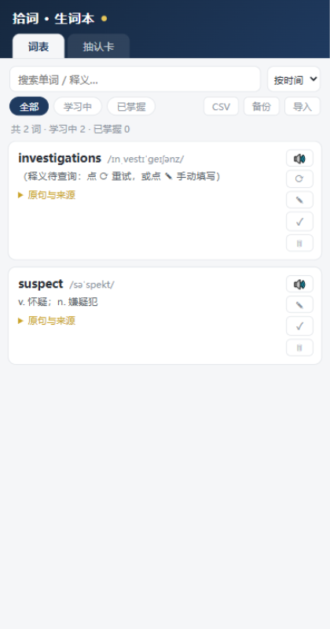
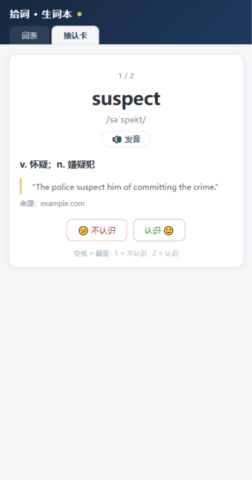

# 拾词 · 生词本（Word Collector）

> **English** · A minimal, privacy-first Edge/Chrome extension for English learners: right-click any word while reading to save it — with automatic Chinese translation, phonetics, and the original sentence where you met it. Review with built-in flashcards, export to CSV/Anki anytime. All data stays in your browser, no account, no server.

阅读英文读物时遇到的生词，**选中 → 右键** 一键收录：自动查中文释义和音标、保留你遇到这个词的**原句上下文**和来源，侧边栏抽认卡复习，可导出 CSV（Excel / Anki）或 JSON 备份。

数据全部保存在浏览器本地（`chrome.storage.local`），**不需要注册、没有服务器、不上传任何数据**；唯一的网络请求是收录时把单词本身发往词典接口查询释义。

## 功能特性

- 🖱️ **右键收录**：选中单词或短语 → 右键「收录到生词本」→ 页面浮出确认提示，扩展角标显示今日新增（每日零点重置）
- 📖 **自动查词**：有道词典中文释义 + 音标，查不到时退回 dictionaryapi.dev 英文释义，再不行可手动编辑
- 📝 **原句上下文**：记录遇到生词时的完整句子、来源网址和日期——复习时最好的记忆钩子
- 🔁 **重复计数**：同一个词再次遇到自动累加（×2、×3…），上下文更新为最近一次
- 🗂️ **词表管理**：搜索、排序、筛选（全部/学习中/已掌握）、发音、手动改释义、标记掌握、删除
- 🃏 **抽认卡复习**：翻面回想 → 认识/不认识；不认识的词本轮末尾重现，错得多的词优先排队；支持键盘快捷键（空格翻面、1 不认识、2 认识）
- 🔊 **单词发音**：调用浏览器内置语音合成（Edge 自带高质量自然语音）
- 💾 **导出备份**：CSV（UTF-8 BOM，Excel 直接打开，可导入 Anki）+ JSON 完整备份/恢复

## 界面预览

| 词表 | 抽认卡 |
| --- | --- |
|  |  |

## 安装（免商店，加载解压缩的扩展）

适用于 Edge 116+ / Chrome 116+：

1. 打开扩展管理页：Edge 输入 `edge://extensions`（Chrome 输入 `chrome://extensions`）
2. 打开**「开发人员模式」**开关
3. 点击**「加载解压缩的扩展」**，选择本项目的 `word-collector` 文件夹（即包含 manifest.json 的目录）

**想在本地 HTML 文件里用**（本地英文电子书等）：进入扩展详情页，打开**「允许访问文件 URL」**。

> 也可以从 [Releases](../../releases) 页面下载 zip 包解压后加载，内容一致。

## 使用方法

### 收录生词

1. 在任意网页（或本地 HTML）阅读时，**选中一个不认识的单词或短语**
2. **右键 → 「收录到生词本：xxx」**
3. 页面顶部浮出 `✓ xxx 已收录` 即成功；释义在后台几秒内自动补全
4. 同一个词再次收录会累加遇到次数，并更新为最近一次的原句

### 复习

点击工具栏图标打开弹窗（今日统计 + 最近收录），点**「打开生词本复习」**进入侧边栏：

- **词表页**：每个词可发音 🔊、编辑释义 ✎、重新查词 ⟳（仅在无释义时出现）、标记已掌握 ✓（再点 ↩ 恢复）、删除 🗑（有确认提示）；展开「原句与来源」查看遇到这个词的句子和出处
- **抽认卡页**：显示单词 → 心里回想 → 点**「显示答案」**看释义和原句 → 标记**认识 / 不认识**。已掌握的词不进入队列
- 复习建议：每天 5 分钟，过一遍近期收录的词，连续认识的标记为已掌握

### 导出 / 备份

词表页右上角：

- **CSV**：Excel 双击直接打开；导入 Anki 时字段为「单词、音标、释义、英文释义、原句上下文、来源、收录时间、遇到次数、状态」，选前 5 列做正反面即可
- **备份**：导出完整 JSON
- **导入**：选择之前的 JSON 备份合并恢复（同名词以备份为准覆盖，其余保留，导入前有确认）

## 数据与隐私

- 所有数据保存在 `chrome.storage.local`，仅存在于当前浏览器配置文件中，**卸载扩展会连数据一起删除**——请定期用「备份」导出 JSON
- 网络请求仅有一类：收录/重查释义时把**单词本身**分别发往有道词典（`dict.youdao.com`）和 dictionaryapi.dev，查完即止，无任何统计上报
- 有道接口为公开非官方用法，若接口变动会自动退回英文释义，也可手动填写

## 已知限制

- 浏览器**内置 PDF 查看器**里无法收录（Chromium 不允许扩展注入），网页和本地 HTML 均正常
- **词形变化不合并**：`runs` / `ran` / `run` 会存为独立词条（见 Roadmap）

## 目录结构

```
word-collector/
├── manifest.json               # MV3 清单
├── background/service-worker.js  # 右键菜单、查词、角标、每日重置
├── content/content.js            # 选区上下文提取、页内 toast
├── popup/                        # 工具栏弹窗
├── sidepanel/                    # 侧边栏：词表 + 抽认卡
├── lib/store.js                  # 共享数据层（改数据结构先看这里）
├── icons/                        # 图标
├── docs/                         # 文档截图
└── tools/                        # 开发工具（图标生成、本地调试服务器、测试页）
```

纯原生 HTML/CSS/JS，无构建步骤——改完代码在扩展页点「重新加载」即生效。

## 开发与调试

```bash
# 重新生成图标（改 tools/make_icons.py 后）
python tools/make_icons.py

# 本地调试侧边栏（带 chrome mock，无需装扩展）
python tools/serve_test.py 8765
# 浏览器打开 http://127.0.0.1:8765/tools/test-sidepanel.html
```

## Roadmap

- [ ] 简单词形还原（-s / -es / -ed / -ing 归并到原形）
- [ ] SM-2 间隔重复调度（每日到期词自动排队）
- [ ] 双击收录开关（当前仅右键菜单）
- [ ] 生词本内直接修改已收录词的释义

## 许可证

[MIT](LICENSE)
